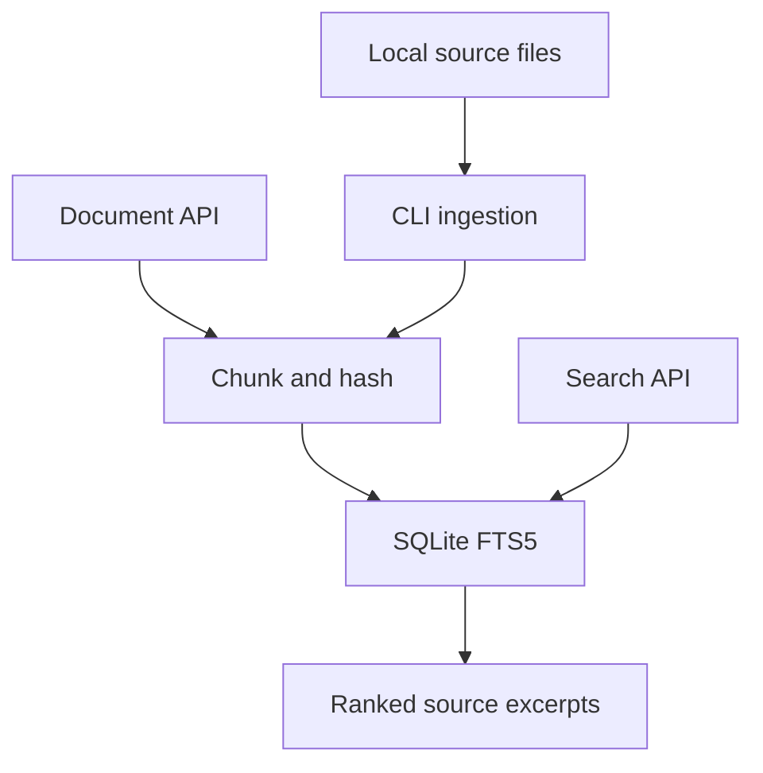

# DevDocs AI

A developer-documentation search project. The current implementation ingests local text and source files, stores overlapping chunks with line references, and returns BM25-ranked search results through FastAPI.

**Status: working lexical retrieval baseline.** Embeddings, vector search, RAG answers, reranking, and a frontend are future work. This repository does not establish the previously cited 1,000-file / 5,000-chunk / 250-query / 85% Recall@5 results.

## What works

- UTF-8 document ingestion through an API or an explicit local-directory CLI.
- Atomic per-source replacement and SHA-256 change detection; repeat ingestion avoids duplicate chunks.
- 30-line chunks with 5-line overlap and original source/start/end line metadata.
- Persistent SQLite FTS5 index, BM25 ranking, bounded queries, and safe literal search terms.
- Document-level Recall@k evaluation with corpus and qrels hashes, per-query results, and runtime metadata.
- Unit/API tests and a CI workflow. See [validation](docs/VALIDATION.md) for actual execution evidence.

## Architecture



The API accepts text, not server file paths or URLs. This keeps repository crawling and network access outside the server. SQLite keeps this first baseline reproducible without credentials or model downloads. Lexical retrieval gives an explainable comparison point for a later semantic retriever; it cannot resolve paraphrases the way embeddings might. Chunks are line-based rather than AST-aware, so functions may span chunks. Scores are SQLite BM25 values, with lower scores ranking first; they are not confidence probabilities.

## Run locally

Requires Python 3.12+ with SQLite FTS5 enabled. From the repository root:

```bash
python3 -m venv .venv
source .venv/bin/activate
python -m pip install -r requirements.lock
python -m backend.ingest evaluation/corpus
uvicorn backend.app.main:app --host 127.0.0.1 --port 8000
```

The default database is `.data/devdocs.sqlite3`. Optionally `export DEVDOCS_DB_PATH=/path/to/index.sqlite3` before starting the API and pass the same path as `--db` to the ingestion CLI. `.env.example` is explanatory; files are not auto-loaded. Swagger UI: <http://127.0.0.1:8000/docs>.

```bash
curl -X POST http://127.0.0.1:8000/documents \
  -H 'Content-Type: application/json' \
  -d '{"source":"docs/offsets.md","text":"Persist events before committing Kafka offsets."}'
curl -G http://127.0.0.1:8000/search --data-urlencode 'query=Kafka offsets' --data-urlencode 'k=5'
curl http://127.0.0.1:8000/health
```

`POST /documents` returns source, chunk count, change status, and SHA-256. `GET /search` returns source, start/end lines, content, and score. Input violations return 422; database failures return 503 without exposing internal paths. Documents are limited to 1 MB of UTF-8 text and 10,000 characters per line. `k` is 1–20; query length is 1–500 characters. These model checks do not replace a reverse-proxy body limit.

Optional Docker workflow: `docker compose up --build` exposes the API on loopback and persists the SQLite database in a named volume. Docker execution remains unverified in the initial review environment.

## Tests and evaluation

```bash
python -m pytest -q --cov=backend --cov-report=term-missing
ruff check .
ruff format --check .
python -m backend.evaluate --k 5 --output evaluation/results/smoke.json
```

`evaluation/corpus` has six short, authored documents; `queries.jsonl` has eight smoke queries. Recall is the fraction of labeled relevant **sources** present in the first k **chunk** hits, averaged across queries. Duplicate chunks from one source count once toward recall but consume result positions. Every query must have a nonempty relevance set naming existing sources; unknown judgments fail evaluation. This fixture checks wiring and metric correctness. It is too small and too closely related to the corpus to establish general retrieval quality. No production-scale performance result is claimed.

## Boundaries and next steps

This is a single-user local tool: no authentication, tenancy, rate limiting, semantic embeddings, answer generation, or browser UI. Secret-pattern detection is not implemented; inspect a corpus before indexing it. The CLI skips hidden paths, common build folders, unsupported files, oversized files, and symlinks. Changed sources replace prior chunks, but deleted files require a fresh index; deletion synchronization is not implemented. SQLite serializes writes, and schema migrations are not yet provided.

See [the implementation roadmap](docs/ROADMAP.md). Before featuring AI-quality metrics, add a versioned, permission-safe corpus, independently judged queries, a held-out test split, a semantic baseline, and a reproducible comparison. Keep the small smoke fixture separate from that evaluation.

`requirements.lock` pins the full Python 3.12 development environment used for validation. `requirements-dev.txt` and the runtime requirements describe direct dependencies; regenerate the lock deliberately when updating them.
